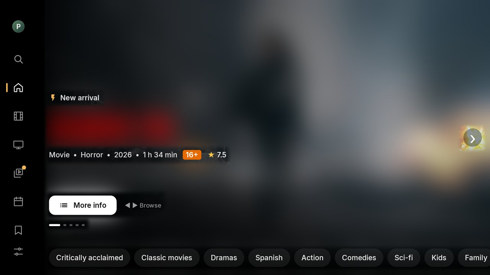
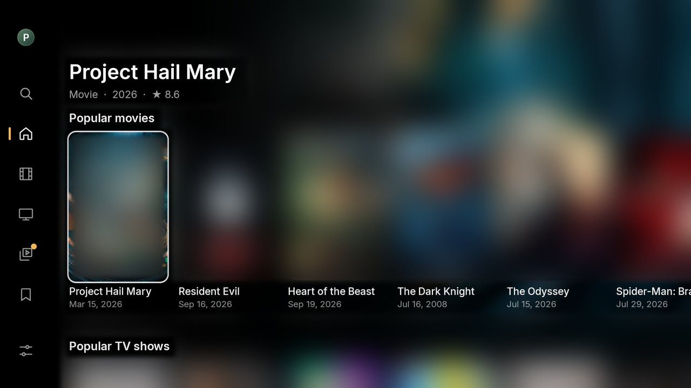
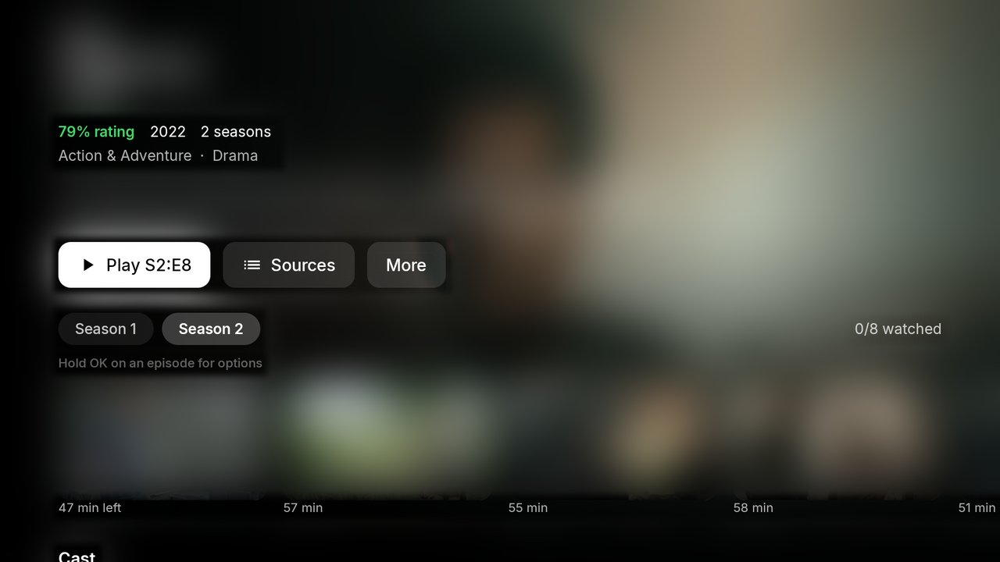
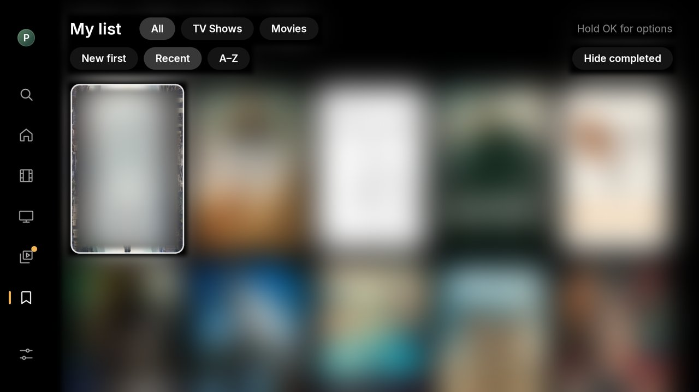
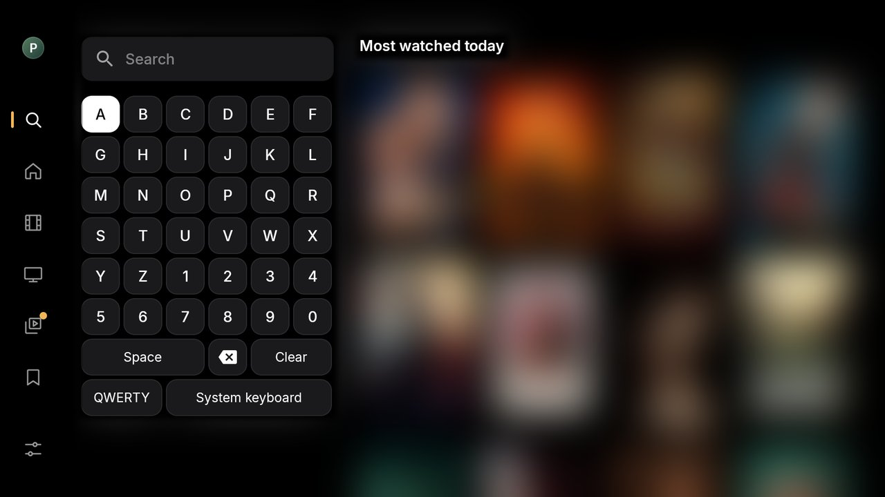

# Franklix

Franklix is a fork of https://github.com/grodri99/bambi.

**This app is under heavy development. It can breaks!**

## Screenshots

Artwork is blurred in these screenshots.

| Home | Home rows |
| --- | --- |
|  |  |
| **Details** | **My List** |
|  |  |
| **Search** | |
|  | |

## Improvements over Bambi 1.0.6

**Playback and sources**

- AllDebrid as the default debrid service, plus Peerflix and Comet as optional providers.
- One ranked source list across providers, with filters and configurable exclusions.
- Format badges (HDR, Dolby Vision, codecs), automatic source failover, and optional frame-rate matching.
- Full remote-control support and a Next episode button in the player.
- Automatic subtitle sync and per-profile subtitle settings.

**Home and discovery**

- Side navigation rail, a new monochrome look and Franklix branding.
- New Home rows: Up Next, Trakt recommendations, Top 10 and unlimited Continue Watching.
- Episode center with optional new-episode notifications.
- Cast and actor pages.
- My List sorting, filters, item actions and Stremio import.
- Android TV Watch Next and a preview channel.

**Trakt, profiles and setup**

- Trakt ratings, recommendations and per-episode watched state.
- PIN-protected, configurable profiles with their own preferences.
- Guided setup from a phone and a Stremio addon manager.

**Performance**

- Smoother scrolling and faster loading on modest devices.
- An offline catalog cache, so My List and Home show content instantly on startup.
- Fewer network requests at startup.

**Security and quality**

- Credentials kept out of plaintext storage and logs.
- Localized interface in Spanish and English.
- Automated tests, CI linting and signed releases.

## Credits

Catalog and images: TMDB. This product uses the TMDB API but is not endorsed or certified by TMDB.
Sync: Trakt.
Sources: Torrentio, Peerflix, Comet, AIOStreams, and the public search engines listed.
Skip intro and credits: IntroDB (collaborative database).
Ideas and logic for several features (skip intro, next episode…) inspired by NuvioTV (GPL-3.0).
Subtitles: OpenSubtitles, Podnapisi, SubDL.
Playback: AndroidX Media3 and dav1d. The tolerant MKV reader is a modified copy of Media3’s MatroskaExtractor (Apache 2.0).

## License

Franklix is free software: you can use, study, modify, and share it under the terms of the GNU General Public License v3.0 (LICENSE). If you distribute a modified version, it must remain GPL-3.0, and its source code must be available. Third-party components retain their respective licenses (the Media3-based MKV reader is Apache 2.0, which is compatible with GPL-3.0).

## Legal notice

Franklix does not host, upload, or distribute content. It is a client that queries third-party services configured by each user with their own accounts and keys. You are responsible for complying with the laws in your country and the terms of the services you use. Franklix is not affiliated with TMDB, Trakt, Real-Debrid, or any of the services mentioned.
